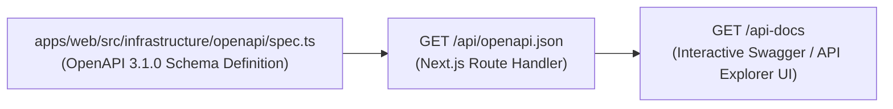

# Swagger UI & OpenAPI 3.1 Specification

`sineva-platform` ships with a built-in OpenAPI 3.1.0 specification endpoint (`/api/openapi.json`) and an interactive documentation explorer (`/api-docs`) so frontend engineers, QA automation, and AI agents can inspect and test every endpoint directly in the browser.

---

## 1. Architecture of `/api/openapi.json` & `/api-docs`

- **Machine-Readable Spec (`/api/openapi.json`)**:
  - Served by `apps/web/src/app/api/openapi.json/route.ts`.
  - Defines reusable component schemas (`ApiResponseEnvelope`, `ResponseMeta`, `PaginationMeta`, `ErrorDetail`, `AgentEntity`, `SendAgentChatRequest`, `SendAgentChatResponse`, `PresignUploadRequest`, `PresignUploadResponse`).
- **Interactive Explorer (`/api-docs`)**:
  - Served by `apps/web/src/app/api-docs/page.tsx`.
  - Renders every endpoint grouped by tag (`System`, `Agents`, `Chat`, `Storage`), displays exact `snake_case` request/response schemas, and includes an interactive **"Try It Live"** request runner.

---

## 2. How to Register a New Endpoint in OpenAPI

Whenever you add a new Route Handler under `apps/web/src/app/api/v1/<resource>/route.ts`:

1. **Add Component Schemas**:
   - Open `apps/web/src/infrastructure/openapi/spec.ts`.
   - Add the request DTO and response data schemas under `components.schemas` using strict `snake_case` property names.
2. **Add Path Operation**:
   - Add the path entry under `paths['/api/v1/<resource>']` with `summary`, `operationId` (`snake_case`), `tags`, `parameters` or `requestBody`, and `responses` (`200`, `400`, `422`, `500`) referencing `#/components/schemas/ErrorResponse`.
3. **Verify**:
   - Run `npm run test` to ensure the OpenAPI route contract test passes, then visit `http://localhost:3000/api-docs`.
