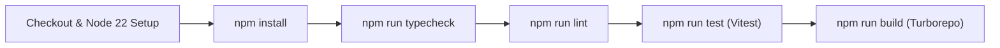

# CI/CD Pipeline & Production Rollout Checklist

---

## 1. GitHub Actions Workflow (`.github/workflows/ci.yml`)

Every push and pull request triggers the automated verification pipeline:

All four quality gates (`typecheck`, `lint`, `test`, `build`) must exit with code `0` before a PR can be merged.

---

## 2. Multi-Stage Production `Dockerfile`

The root [`Dockerfile`](../../Dockerfile) builds a minimal, hardened Node 22 Alpine container image:
1. **`base` / `deps` stage**: Uses `node:22-alpine`, copies root and workspace `package.json` manifests, and installs dependencies.
2. **`builder` stage**: Copies source code and runs `npm run build` (`turbo run build`) to compile `@sineva/shared`, `@sineva/ui`, and `@sineva/web`.
3. **`runner` stage**: Runs with `NODE_ENV=production` on port `3000`.

---

## 3. Production Rollout Checklist

- [ ] **Environment Secrets**: Rotate `POSTGRES_PASSWORD`, `S3_SECRET_ACCESS_KEY`, and `AI_ENGINE_INTERNAL_API_KEY` in production secret storage.
- [ ] **Zero-Port Check**: Confirm `docker compose ps` shows host port mapping `0.0.0.0:3000->3000/tcp` for `sineva-platform` and only `8000/tcp` (no host IP) for `sineva-ai`.
- [ ] **Health Verification**: Query `GET /api/v1/health` and verify `status === 200` and `data.dependencies.ai_engine_status === "reachable"`.
- [ ] **OpenAPI Verification**: Load `/api-docs` and `/api/openapi.json` to confirm all endpoint schemas render properly.
