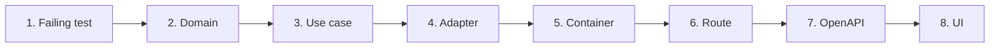

# Feature Development Workflow

A feature is built as a vertical slice: test, domain, use case, adapter, container, route, OpenAPI, then UI. Each step starts with a failing test (R-01, [ADR-0007](../decisions/0007-tdd-fakes-integration-containers.md)). Skip a step only when the feature does not touch that layer.

## 0. Before you start

1. State your assumptions. If the request has two readings, list them and ask (R-06).
2. Check the feature against the product rules now, not at review: guardrails (R-34), wording (R-33), @mention syntax (R-36), canonical slugs (R-37), generic integrations (R-35). SinoPeople never hires or rejects, SinoSales proposals and SinoSocial posts stay drafts until a person approves, SinoFinance never moves money, SinoInsights is read-only, SinoHelp escalates new, sensitive or uncertain cases.
3. Read the [known issues](known_issues_and_tech_debt.md) for the area. Do not copy a listed pattern.
4. Check whether the feature changes the database or the sineva-ai contract. Both have extra steps below.

## 1. Where files go

| Artifact | Location |
| :--- | :--- |
| Entity, value types | `src/server/domain/entities/<name>.ts` |
| Port (repository or gateway interface) | `src/server/domain/repositories/<name>.ts` |
| Domain error | `src/server/domain/errors/domain_error.ts` |
| Zod DTO | `src/server/application/dtos/<name>_dto.ts` |
| Use case | `src/server/application/use-cases/<verb>_<noun>_use_case.ts` |
| Adapter | `src/server/infrastructure/{database,cache,storage,gateways}/` |
| Container getter | `src/server/container.ts` |
| Route handler | `src/app/api/v1/<path>/route.ts` |
| OpenAPI entry | `src/server/infrastructure/openapi/spec.ts` |
| Browser-facing type and its guard | `src/shared/<name>_view.ts` and `src/server/http/<name>_view_contract.ts` |
| UI | `src/client/components/`, `src/client/store/slices/`, pages in `src/app` |
| Fakes | `src/__tests__/fakes/fake_<name>.ts` |
| Tests | `src/__tests__/` (unit, route and store), `contract/`, `integration/` |

## 2. The slice, in order



### 1. Failing test first

Pick the layer the behavior lives in and write the test there. Run it and read the failure: it must fail for the reason you expect (a missing export is not a red test). Keep the output for the PR (R-01, R-04).

| Behavior | Test style | Example file |
| :--- | :--- | :--- |
| Use case logic | Use case plus fakes, no DB, no network | `use_cases.test.ts` |
| Route status, envelope, validation | Call the route's exported `POST` or `GET` with a `NextRequest`, with `vi.mock('@/server/container')` returning use cases built on fakes | `api_routes.test.ts` |
| Adapter behavior without a DB | Instantiate the adapter directly | `adapters.test.ts` |
| sineva-ai gateway | Stub `fetch`, compare with the copied fixtures | `contract/internal_ai_engine_gateway.contract.test.ts` |
| Prisma repository | Real Postgres | `integration/*.int.test.ts` |
| Redux slice | `makeStore()`, dispatch, read state | `store.test.ts` |

### 2. Domain

- Add the entity with `snake_case` fields, the port method with domain types only, and an error class if the failure is new. A port method that can fail documents its errors with `@throws`, as `AiEngineGateway` does.
- Add the method to the matching fake so use-case tests can run.

### 3. Application

- Add the DTO schema, and the use case with ports injected through the constructor and an `execute` method. Make the test pass with the smallest code.

### 4. Adapter

- Implement the port. Convert driver and upstream failures into domain errors and rethrow what you do not understand. No fallback data ([error handling](../engineering/error_handling_and_failure_modes.md)).
- Add `import 'server-only';` as the first line of every file under `infrastructure`. `architecture.test.ts` fails without it.

**If the feature changes the database:**

1. Edit `apps/web/prisma/schema.prisma`: `@@schema("platform")`, `@@map("<snake_case_plural>")`, UUID `id` with `gen_random_uuid()` ([ADR-0014](../decisions/0014-uuid-primary-keys.md)).
2. Generate the migration against a throwaway database with a plain `DATABASE_URL`, using `db:migrate:dev`. Never run `migrate reset` or `db push`, and never accept a reset prompt, against a shared or persistent database (R-18, R-19).
3. Commit the new folder under `prisma/migrations/` (R-20). Never edit the generated client (R-22).
4. Run `db:generate`, then write the integration test red first, then green, with `npm run test:integration` (`TEST_DATABASE_URL` must name a database containing "test").
5. Shared and production databases receive the migration through `db:migrate:deploy` with `?schema=platform`, as a release step. The full procedure and the reason for the two URLs are in [database migrations workflow](../engineering/database_migrations_workflow.md).

**If the feature changes the sineva-ai contract** ([ADR-0015](../decisions/0015-sineva-ai-owns-internal-chat-contract.md), R-40):

1. Change the DTOs and fixtures in sineva-ai first (`tests/contract/fixtures`). sineva-ai owns the contract and the platform adapts.
2. Copy the fixtures byte-for-byte into `src/__tests__/contract/fixtures/`. Do not edit the copies.
3. Update the contract test, the gateway's Zod schema in `internal_ai_engine_gateway.ts`, the `AiEngine*` types in `ai_engine_gateway.ts`, the view in `src/shared/chat_view.ts` and its guard `chat_view_contract.ts`.
4. Ship both repositories together. A fixture that lands in one repo only is a broken contract.

### 5. Container

Add a lazy memoized getter in `src/server/container.ts`. This is the only place that constructs the adapter (R-10).

Gotcha: route tests replace the container with a `vi.mock` factory, so a missing getter does not fail them. Add the getter to the mock in the same change. `npm run typecheck` catches an import of a getter that does not exist.

### 6. Route

Keep it to three steps: `parse` the body or query with the DTO, call the use case from `@/server/container`, return through `sendSuccessJson`, `sendPaginatedJson` or `handleRouteError`. No business logic and no infrastructure imports (R-11, R-24). Test the success status, a 422 for a bad body and each domain error the use case can throw. A new route that needs a user or workspace identity must not take it from the body (R-27): flag the gap in the PR.

### 7. OpenAPI

Register the path, the request and response schemas and every status it can return, including 404, 409, 422, 502 and 503 where they apply, in `server/infrastructure/openapi/spec.ts` (R-25). Check `GET /api/openapi.json`. See [swagger and OpenAPI](../api-spec/swagger_and_openapi.md).

### 8. UI

Follow [frontend architecture](../project-structure/frontend_architecture.md): server component first, small client islands, URL for selection, `loading.tsx`, `error.tsx` and `not-found.tsx` for the route (R-31), Redux only for client-only state, tokens not hex (R-30), WCAG 2.2 AA (R-32). If the browser reads a new payload, it imports its type from `src/shared`. Write the copy to the wording rules.

## 3. Docs, verification and PR

1. Update the docs the change touches in the same change (R-38): `api-spec` for endpoints, the relevant engineering doc, `known_issues_and_tech_debt.md` if you added or removed debt, and the `docs/README.md` index when you add or move a file.
2. Run the full check and paste the results:
   ```bash
   npm run lint && npm run typecheck && npm run test && npm run build
   npm run test:integration   # when database code changed
   ```
   CI runs the first four and has no Postgres, so it does not run the integration tests (known gap). You are the only check for them (R-02).
3. Commit with Conventional Commits, one type per commit, subject in imperative mood and lowercase, 72 characters or fewer (R-03). A feature that spans unrelated types is split.
4. Open the PR with the full template. Every ticked item needs evidence: the red output, the green output, the verification commands, screenshots for UI (R-04). Report adjacent problems in the notes instead of fixing them (R-05). Details: [git and PR workflow](../governance/git_and_pr_workflow.md).
