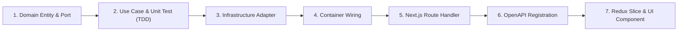

# Feature Development Workflow (Vertical Slice Guide)

Follow this 7-step playbook whenever adding a new endpoint, domain capability, or UI workflow to `sineva-platform`.

---

## Step-by-Step Vertical Slice Playbook

### Step 1: Define Domain Entity & Repository/Gateway Interface (`src/domain/`)
- Create or update the entity in `apps/web/src/domain/entities/` using `snake_case` fields.
- Declare the required repository or gateway method in `apps/web/src/domain/repositories/`.

### Step 2: Write Failing Use Case Test & Implement Use Case (`src/application/`)
- Create a unit test `apps/web/src/application/use-cases/<feature>.test.ts` first (Red phase).
- Implement the Use Case class in `apps/web/src/application/use-cases/<feature>.ts` with constructor-injected domain interfaces until the test passes (Green phase).

### Step 3: Implement Infrastructure Adapter (`src/infrastructure/`)
- Implement the interface in Drizzle ORM (`src/infrastructure/database/`), S3 (`src/infrastructure/gateways/`), or `AiEngineHttpGateway`.

### Step 4: Wire in Dependency Container (`src/infrastructure/container.ts`)
- Expose the instantiated Use Case on `PlatformContainer`.

### Step 5: Create Next.js Route Handler (`src/app/api/v1/.../route.ts`)
- Parse query/body parameters, validate `snake_case` keys, execute the Use Case, and return `NextResponse.json(createSuccessResponse(...), { status })`.
- Add a Route Handler contract test verifying the `ApiResponse<T>` envelope.

### Step 6: Register in OpenAPI (`src/infrastructure/openapi/spec.ts`)
- Add the new endpoint and schemas so `/api/openapi.json` and `/api-docs` stay 100% synchronized.

### Step 7: Connect to Redux Toolkit & UI (`src/presentation/`)
- Add an async thunk or action in `workspace_slice.ts` and bind it to the workspace UI using semantic design tokens.
- Run `npm run typecheck && npm run lint && npm run test && npm run build`.
