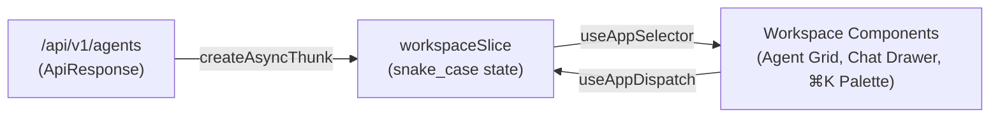

# State Management with Redux Toolkit

`sineva-platform` uses **Redux Toolkit (`@reduxjs/toolkit`)** and **React-Redux (`react-redux`)** in `apps/web/src/presentation/store/` to manage cross-cutting client state across the AI workspace.

---

## 1. Store Architecture & `snake_case` State Contract

All Redux state properties match the platform-wide `snake_case` convention. This allows API payloads from `/api/v1/*` (`ApiResponse<T>`) to hydrate Redux slices directly without key transformation mappers.



---

## 2. State Slice Structure (`workspace_slice.ts`)

```typescript
export interface WorkspaceState {
  agents: AgentEntity[];
  active_agent_slug: string;
  selected_department: string;
  search_query: string;
  is_command_palette_open: boolean;
  chat_history_by_agent: Record<string, ChatMessageItem[]>;
  is_loading_agents: boolean;
  is_sending_chat: boolean;
  last_error_message: string | null;
}
```

### Core Actions & Reducers
- `set_active_agent_slug(PayloadAction<string>)`: Switches the active AI companion (`sino-people`, `sino-finance`, `sino-sales`, `sino-social`, `sino-help`, `sino-insights`).
- `set_selected_department(PayloadAction<string>)`: Filters the companion roster by department (`all`, `hr`, `finance`, `sales`, `marketing`, `support`, `analytics`).
- `toggle_command_palette(PayloadAction<boolean | undefined>)`: Opens or closes the `⌘K` command bar.
- `append_optimistic_message`: Immediately appends the user's message to `chat_history_by_agent[agent_slug]` before the network call completes (Optimistic UI).

---

## 3. Typed Hooks (`hooks.ts`)

Components must never import raw `useDispatch` or `useSelector` from `react-redux`. Always use the pre-typed hooks from `src/presentation/store/hooks.ts`:

```typescript
import { TypedUseSelectorHook, useDispatch, useSelector } from 'react-redux';
import type { RootState, AppDispatch } from './store';

export const useAppDispatch: () => AppDispatch = useDispatch;
export const useAppSelector: TypedUseSelectorHook<RootState> = useSelector;
```

---

## 4. When to Use Redux vs. Local Component State

| State Type | Where It Belongs | Example |
| :--- | :--- | :--- |
| **Global Workspace State** | Redux (`workspaceSlice`) | Active companion (`active_agent_slug`), `⌘K` palette visibility, agent roster, conversation transcripts. |
| **Ephemeral Form Input** | Local `useState` | Unsubmitted text inside the chat composer input box, hover states, dropdown open state. |
| **Theme Mode** | `next-themes` + CSS Tokens | Light/Dark theme toggle (`data-theme` / `.dark`). |
