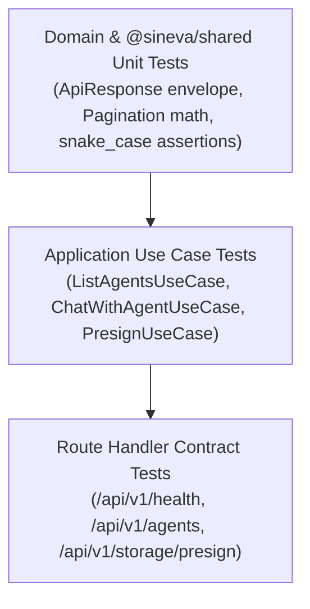

# Testing Strategy & CI Pipeline

`sineva-platform` follows a **Test-Driven Development (TDD)** workflow powered by **Vitest**. Every package (`@sineva/shared`, `@sineva/ui`, `@sineva/web`) includes fast, deterministic tests executed automatically on every push and pull request.

---

## 1. Testing Pyramid & Coverage Scope



### 1.1 `@sineva/shared` Unit Tests (`packages/shared/src/*.test.ts`)
- Verifies `createSuccessResponse`, `createPaginatedResponse`, and `createErrorResponse`.
- Verifies edge cases in pagination math (`per_page = 0`, `total_items = 0`, `has_next`, `has_prev`).
- Verifies `snake_case` conversion and deep key validation (`assertSnakeCaseKeys`).

### 1.2 Application Use Case Tests (`apps/web/src/application/**/*.test.ts`)
- Tests use cases in complete isolation from PostgreSQL, Redis, and Docker by injecting `InMemoryAgentRepository` and mock gateways.
- Verifies domain error throwing (`EntityNotFoundError`, `DomainValidationError`) on invalid inputs.

### 1.3 Route Handler Contract Tests (`apps/web/src/app/api/**/*.test.ts`)
- Invokes Next.js Route Handlers (`GET`, `POST`) directly with synthetic `NextRequest` objects.
- Asserts that every HTTP response matches the `ApiResponse<T>` envelope and that all JSON keys in `data` and `meta` are strictly `snake_case`.

---

## 2. Running Tests Locally

```bash
# Run all tests across the Turborepo monorepo
npm run test

# Run tests only in @sineva/shared
npm --workspace=@sineva/shared run test

# Run tests only in @sineva/web
npm --workspace=@sineva/web run test
```

---

## 3. GitHub Actions CI Pipeline (`.github/workflows/ci.yml`)

Every commit to `main`/`master` and every pull request runs the following sequential quality gates on Node.js 22:
1. **`npm install`**: Installs workspace dependencies cleanly.
2. **`npm run typecheck`**: Runs `turbo run typecheck` (`tsc --noEmit`) across all packages.
3. **`npm run lint`**: Runs `turbo run lint` (`eslint`) with zero-error enforcement.
4. **`npm run test`**: Runs `turbo run test` (`vitest run`) across all packages.
5. **`npm run build`**: Runs `turbo run build` to verify full production Next.js compilation.
