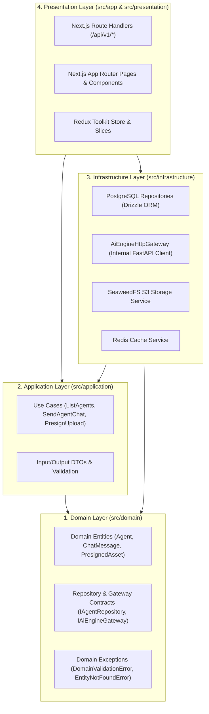

# Clean Architecture Layers & Dependency Rules

Inside `apps/web/src`, code is structured according to **Clean Architecture** (Robert C. Martin) and **Domain-Driven Design (DDD)**. All source code dependencies point strictly **inward** toward the `domain` layer. Inner layers never know about outer layers (e.g., `domain` and `application` never import `next/server`, `drizzle-orm`, `ioredis`, or `react`).

---

## 1. Layer Dependency Diagram

---

## 2. Detailed Layer Responsibilities

### 2.1 Domain Layer (`apps/web/src/domain/`)
The heart of the software. Contains enterprise business rules, immutable entity types, and abstract contracts (ports).
- **Contents**:
  - `entities/`: Core data structures with `snake_case` properties (e.g., `AgentEntity`, `AgentChatMessage`, `StoragePresignTicket`).
  - `repositories/`: Interfaces for persistence and external gateways (`IAgentRepository`, `IAiEngineGateway`, `IStorageGateway`).
  - `errors/`: Pure domain error classes (`DomainError`, `EntityNotFoundError`, `ValidationError`, `UpstreamGatewayError`).
- **Forbidden Imports**: `react`, `next/*`, `drizzle-orm`, `pg`, `ioredis`, `@aws-sdk/*`, `axios`.

### 2.2 Application Layer (`apps/web/src/application/`)
Contains application-specific business rules (use cases). Each use case coordinates one atomic user or system intent by invoking domain interfaces.
- **Contents**:
  - `use-cases/`: Single-responsibility classes with an `execute(input)` method (e.g., `ListAgentsUseCase`, `CreateAgentUseCase`, `ChatWithAgentUseCase`, `GeneratePresignedUploadUseCase`).
  - `dtos/`: Input/output Data Transfer Objects with strict `snake_case` keys and runtime validation helpers.
- **Allowed Imports**: `src/domain/**`, `@sineva/shared`.
- **Forbidden Imports**: Concrete database clients, `fetch`/`NextRequest`/`NextResponse`, React hooks, or Redux slices.

### 2.3 Infrastructure Layer (`apps/web/src/infrastructure/`)
Provides concrete implementations (adapters) of the interfaces defined in `src/domain/repositories/`.
- **Contents**:
  - `database/`: Drizzle ORM schema definitions (`schema.ts`), PostgreSQL connection pool, and repository implementations (`DrizzleAgentRepository`, `InMemoryAgentRepository`).
  - `gateways/`:
    - `ai_engine_http_gateway.ts`: Communicates with `http://sineva-ai:8000` over `sineva_internal`, injecting `X-Internal-Api-Key` and `X-Request-Id`.
    - `seaweedfs_storage_gateway.ts`: Generates S3-compatible presigned URLs against `http://seaweedfs-s3:8333`.
  - `cache/`: Redis client (`ioredis`) with `sineva:platform:` key prefixing.
  - `container.ts`: Lightweight dependency injection factory wiring repositories and gateways into use cases.
- **Allowed Imports**: `src/domain/**`, `src/application/**`, `@sineva/shared`, third-party SDKs (`drizzle-orm`, `@aws-sdk/client-s3`, `ioredis`).

### 2.4 Presentation Layer (`apps/web/src/presentation/` & `apps/web/src/app/`)
Adapts external HTTP requests and browser events to Application Use Cases.
- **Contents**:
  - `src/app/api/v1/**`: Next.js Route Handlers that parse requests, execute a Use Case from the container, and format the output using `createSuccessResponse`, `createPaginatedResponse`, or `createErrorResponse` from `@sineva/shared`.
  - `src/app/api-docs/**` & `src/app/api/openapi.json`: Interactive Swagger UI and OpenAPI 3.1 specification generator.
  - `src/presentation/store/`: Redux Toolkit store, typed hooks (`useAppDispatch`, `useAppSelector`), and `snake_case` state slices.
  - `src/presentation/components/`: AI-Native workspace UI components (`CommandPalette`, `AgentCompanionCard`, `ChatComposer`, `SystemStatusBanner`).

---

## 3. Layer Boundary Checklist for Code Reviews

| Rule | Check |
| :--- | :--- |
| Does any file in `src/domain/` import from `src/application/`, `src/infrastructure/`, or `src/presentation/`? | **Must be NO** |
| Does any Use Case in `src/application/` instantiate a concrete DB/HTTP client directly instead of receiving an interface via constructor injection? | **Must be NO** |
| Do all Route Handlers in `src/app/api/v1/` return `ApiResponse<T>` via `@sineva/shared`? | **Must be YES** |
| Are all entity fields, DTO properties, and API payloads formatted in `snake_case`? | **Must be YES** |
