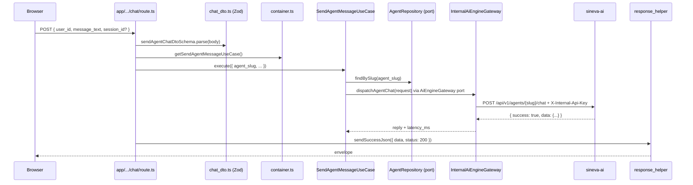

# Clean Architecture Layers and Dependency Rules

Rules: R-07 to R-14 in [agent rules](../governance/agent_rules.md). Decision: [ADR-0004](../decisions/0004-web-app-structure-and-dependency-rules.md).

Backend code lives under `apps/web/src/server`, split into four layers plus a composition root. Imports point inward: `domain` knows nothing about the others. "Current" below is what the code and tests do today; "Target" is decided but not built.

## 1. Layer table

| Layer | Path | May import | May not import | Enforced by |
| :--- | :--- | :--- | :--- | :--- |
| app (routing edge) | `src/app` | `@/server/container`, `@/server/http`, `@/server/application/dtos`, `@/client`, `@/shared`, `@sineva/*`, the static OpenAPI spec | `@/server/infrastructure` (except `openapi`) | `architecture.test.ts` |
| http | `src/server/http` | `@/server/domain`, `@/shared`, `@sineva/shared`, `next/server`, `zod` | Nothing is blocked | Review only |
| application | `src/server/application` | `@/server/domain`, `zod` | `@/server/infrastructure`, `@/server/http`, `next`, `react`, `react-dom` | `architecture.test.ts` |
| infrastructure | `src/server/infrastructure` | `@/server/domain`, SDKs and drivers (`@prisma/*`, `ioredis`, `@aws-sdk/*`), `zod` | `@/server/application`, `@/server/http` | `architecture.test.ts` |
| domain | `src/server/domain` | Itself. Debt: one type import from `@sineva/shared` | `@/server/application`, `infrastructure`, `http`; `next`, `react`, `react-dom`; ORMs, drivers, AWS SDK | `architecture.test.ts` |
| container | `src/server/container.ts` | Everything under `server`, including concrete adapters | Nothing is blocked. It is the one file allowed to construct adapters | `server-only` marker test; the "only here" part is a review rule |
| client | `src/client` | `@/shared`, `@sineva/ui`, `@sineva/shared` | `@/server/**`, `server-only` | ESLint `no-restricted-imports` and `architecture.test.ts` |
| shared | `src/shared` | Nothing (type declarations only) | `@/server/**`, `@/client/**` | Review only |

## 2. What `architecture.test.ts` checks

The test (`apps/web/src/__tests__/architecture.test.ts`) reads every `.ts` and `.tsx` file under a folder, strips comments, extracts import specifiers with a regex, and turns relative paths into `@/...` form so `../../server/x` cannot dodge a rule. Type-only imports count as imports. It checks:

1. The directories `server/domain`, `server/application`, `server/infrastructure`, `server/http`, `client/components`, `client/store`, `shared` and the file `server/container.ts` exist, and the old top-level `src/domain`, `src/application`, `src/infrastructure`, `src/presentation` do not.
2. `client` imports neither `@/server` nor `server-only`.
3. `domain` imports none of `@/server/application`, `infrastructure`, `http`, `next`, `react`, `react-dom`, `drizzle-orm`, `drizzle-kit`, `pg`, `ioredis`, `redis`, `prisma`, `@prisma/*`, `@aws-sdk/*`.
4. `application` imports none of `@/server/infrastructure`, `@/server/http`, `next`, `react`, `react-dom`.
5. `infrastructure` imports neither `@/server/application` nor `@/server/http`.
6. Every file under `server/infrastructure` (except `database/generated/`, which `prisma generate` emits) and `server/container.ts` contains the line `import 'server-only';`.
7. Files under `app` import nothing from `@/server/infrastructure`, except `@/server/infrastructure/openapi`.

## 3. What it does not check

Treat these as review items. Gaps are listed so nobody assumes coverage that is not there.

- `application` is only blocked from specific layers and packages. It can still import an ORM or an SDK, and the test would pass.
- `domain` may import `@sineva/shared` and `zod`. `domain_error.ts` already imports `ErrorDetail` from `@sineva/shared` (Target: remove it).
- `http` is never scanned: it can import `application` or `infrastructure` unnoticed.
- `infrastructure` importing `@/app` or `@/client`, and `server` importing `@/client`, are not checked.
- `client` is only checked for `@/server` and `server-only`. It could import `ioredis` or `@aws-sdk/*` and pass the test.
- `src/shared` is never scanned.
- Adapters constructed outside `container.ts` (R-10): use the grep in the rule.
- Route handlers staying thin (R-11): nothing measures it.
- `src/__tests__` is not scanned. Tests may import anything.
- Imports through the `require` and dynamic `import()` forms are matched. Specifiers built from variables are not.

## 4. The container

`server/container.ts` is the only place that knows which concrete class backs each port. It exposes one getter per use case: `getListWorkspaceSpecialistsUseCase`, `getSendAgentMessageUseCase`, `getPresignStorageUploadUseCase`, `getSystemHealthUseCase`. Adapter getters (`getCacheRepository`, `getAiEngineGateway`, `getStorageRepository`) are private to the module.

Every getter is wrapped in a local `memoize` helper, so nothing is built at import time. Reason: `next build` imports every route module to collect page data. Adapter constructors read env and may open connections, so building them on import would touch real infrastructure during a build and make env-dependent tests order-sensitive. Adapters are memoized because they own resources shared across requests (the Prisma connection pool, cache and storage clients).

Gotchas:

- Memoized getters keep state for the life of the process. `container.ts` has no reset function today. Route tests replace the whole module with `vi.mock('@/server/container', ...)` and hand it use cases built on fakes (see `api_routes.test.ts`).
- `getEnvConfig()` is not memoized: it reads `process.env` on each call. The container calls it once, when it builds `getSystemHealthUseCase`, for the bucket name.
- A new adapter or use case needs a new getter here and nowhere else. If a route handler or page needs `new SomethingRepository()`, the design is wrong.

## 5. `server-only`

`import 'server-only';` makes a client import of that module fail at build time instead of leaking secrets or Node-only code into the browser bundle. The real package throws outside a React Server Components build, so Vitest aliases it to `src/__tests__/stubs/server_only.ts` (`vitest.config.ts` and `vitest.integration.config.ts`). Keep that alias, or every test that touches infrastructure or the container crashes on the guard import.

`domain`, `application` and `http` do not carry the marker. They hold no secrets, and `src/shared` types must stay importable from the client.

## 6. Shared view types and compile-time guards

The browser must not import `@/server/**`, so the shapes it reads live in `src/shared`: `specialist_view.ts` (`WorkspaceSpecialistRosterView`) and `chat_view.ts` (`ChatReplyView`, `ChatToolCallView`, `ChatCitationView`). Route handlers serialize domain objects directly, so the two declarations could drift. Two files in `src/server/http` prevent that at type-check time:

- `specialist_view_contract.ts`: `AssertAssignable<WorkspaceSpecialistRoster, WorkspaceSpecialistRosterView>`.
- `chat_view_contract.ts`: `AssertAssignable<AiEngineChatResponse, ChatReplyView>`.

`AssertAssignable` is a type-level check, so it costs nothing at runtime and fails `npm run typecheck` when the server type stops fitting the view. Gotchas:

- It checks one direction. Extra fields on the entity are fine. A field the view declares that the entity lacks, or an entity field whose type became wider than the view's, fails.
- The guard types are exported but imported nowhere. They work because `tsconfig.json` includes `**/*.ts`.
- The specialist category list is declared in `domain/specialists/agent_catalog.ts` (`AGENT_CATEGORIES`) and spelled out again as a union in `shared/specialist_view.ts`; the guard catches drift between them. The Zod enums in `agent_dto.ts` and the gateway schema are built from the domain list.
- Presign and health responses have no view type or guard yet.
- Add a view and a guard together when you add a browser-facing shape (R-14).

## 7. Worked example: `POST /api/v1/agents/{agent_slug}/chat`

1. Route (`src/app/api/v1/agents/[agent_slug]/chat/route.ts`, `POST`). Awaits `context.params` (a Promise in Next 16) for `agent_slug`, reads the body as `unknown`.
2. DTO (`server/application/dtos/chat_dto.ts`). `sendAgentChatDtoSchema` requires `user_id` (3 to 128 chars) and `message_text` (1 to 8000 chars), and accepts an optional `session_id` (must be a UUID) and `context_metadata`. A `ZodError` ends here as a 422 via `handleRouteError`.
3. Container. `getSendAgentMessageUseCase()` builds `SendAgentMessageUseCase` on first call with `PrismaAgentRepository` and `InternalAiEngineGateway`, then reuses it.
4. Use case (`server/application/use-cases/send_agent_message_use_case.ts`). `execute` calls `agentRepository.findBySlug`. A `null` becomes `NotFoundError('Agent', slug)` (404). Otherwise it calls `aiEngineGateway.dispatchAgentChat`. Both are domain ports; the use case never sees Prisma or `fetch`.
5. Port. `AiEngineGateway` in `server/domain/repositories/ai_engine_gateway.ts` documents the two failure types it throws.
6. Gateway (`infrastructure/gateways/internal_ai_engine_gateway.ts`). Builds the URL from `AI_ENGINE_INTERNAL_URL` with `encodeURIComponent(agent_slug)`, sends `user_message` (from `message_text`), `session_id`, `user_id` and `context_metadata`, with header `X-Internal-Api-Key`. The slug travels only in the path, and `tenant_id` is not sent yet (known gap). An `AbortController` set to `AI_ENGINE_TIMEOUT_MS` covers the body read too.
7. Mapping. The body is parsed as JSON and validated with the Zod `chatEnvelopeSchema`. Unknown fields are dropped, so sineva-ai can add fields. The gateway returns the `data` object plus `latency_ms` measured around the call. There is no separate mapper: the public response mirrors sineva-ai's field names ([ADR-0015](../decisions/0015-sineva-ai-owns-internal-chat-contract.md)), and `chat_view_contract.ts` guards it against `ChatReplyView`.
8. Failure branches. Network error, timeout or abort: `UpstreamUnavailableError` (503). Non-2xx, a non-JSON body, or an envelope that fails validation: `UpstreamServiceError` (502). Details in [error handling](../engineering/error_handling_and_failure_modes.md).
9. Response. `sendSuccessJson` in `server/http/response_helper.ts` calls `createSuccessResponse` from `@sineva/shared` and returns `NextResponse.json(payload, { status })`. Any thrown error goes through `handleRouteError`.

## 8. Known debt in this area

- `DomainError` carries an HTTP `status` and imports `@sineva/shared` (`domain_error.ts`). The domain should not know about HTTP.
