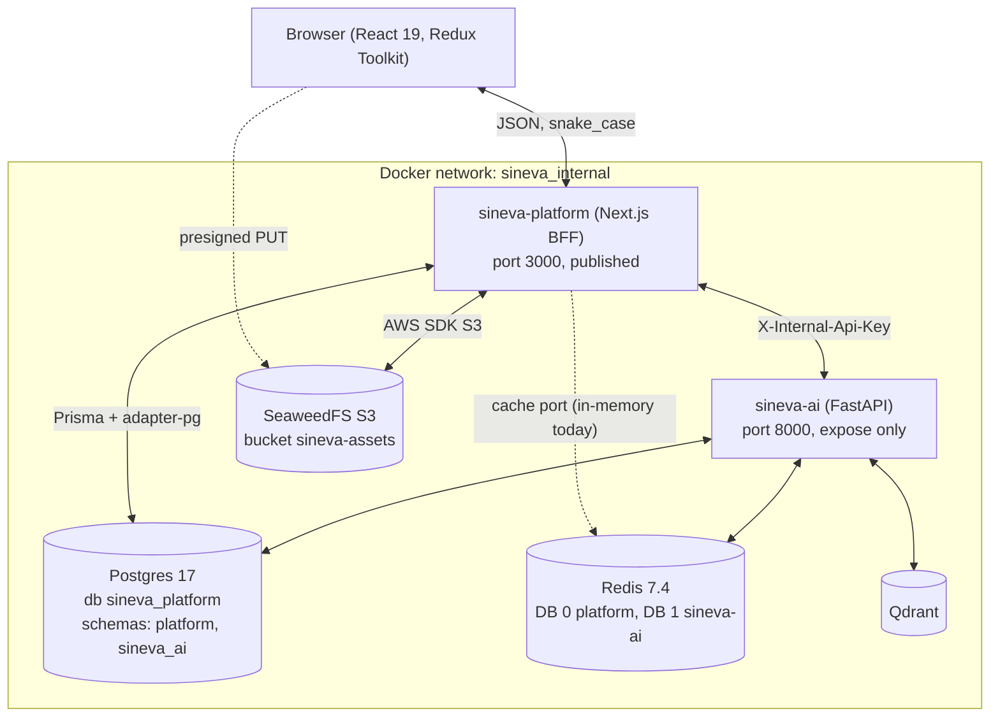

# Architecture and Project Structure Overview

`sineva-platform` is the web app and Backend-for-Frontend (BFF) for the Sineva suite. It is the only public entry point. `sineva-ai` (Python FastAPI) runs the companions and is reachable only from the platform, over the internal Docker network ([ADR-0001](../decisions/0001-bff-gateway.md)).

It is one Next.js 16.4 App Router application in a Turborepo monorepo. The user talks to Sino in one chat and calls a product by @mention ([ADR-0010](../decisions/0010-one-chat-with-mentions.md)). "Current" below is what the code does today. "Target" is decided and not built.

## 1. Topology



The diagram shows who talks to whom, not what is published. `docker-compose.yml` also publishes Postgres (5432), Redis (6379, no password), Qdrant (6333) and the SeaweedFS master, filer and S3 ports (9333, 8888, 8333) on the host. Only `sineva-ai` and `seaweedfs-volume` have no host port ([topology](../deployment/docker_compose_topology.md)).

What is real today:

| Link | Current |
| :--- | :--- |
| Browser to platform | Real. Public routes under `/api/v1/*`. |
| Platform to sineva-ai | Real. `InternalAiEngineGateway` calls it with `X-Internal-Api-Key` ([ADR-0013](../decisions/0013-internal-service-auth-header.md)). Failures surface as 502 or 503. |
| Platform to Postgres | Real for agents: `PrismaAgentRepository` over `@prisma/adapter-pg`. Only `agent_configs` has an adapter. The schema also defines `workspaces`, `users`, `chat_sessions`, `chat_messages` and `storage_objects`, which no code reads or writes yet. |
| Platform to Redis | Real. `RedisCacheRepository` uses `ioredis` with a key prefix and TTL, and `ping()` sends `PING`. There is no in-memory fallback when Redis is down. |
| Platform to SeaweedFS | Real. `SeaweedStorageRepository` presigns against `S3_PUBLIC_ENDPOINT` and a signing failure is a 502. Its health check is `HeadBucket`. |

The shared database holds two schemas: the platform owns `platform`, sineva-ai owns `sineva_ai`, and neither writes to `public` ([ADR-0006](../decisions/0006-shared-postgres-platform-schema.md)). The remaining stubs are listed in [known issues](../development/known_issues_and_tech_debt.md).

## 2. Repository layout

```text
sineva-platform/
  apps/web/                    @sineva/web: the Next.js app and BFF
    prisma/                    schema.prisma, migrations/, seed.ts
    prisma.config.ts
    src/
      app/                     routing edge: pages, layouts, /api/v1/* handlers, /api-docs
      server/                  backend, never shipped to the browser
        domain/                entities, ports (repositories/), errors
        application/           use-cases/, dtos/
        infrastructure/        database, cache, storage, gateways, config, openapi
        http/                  response_helper, agent_view_contract, chat_view_contract
        container.ts           composition root
      client/                  components/, store/
      shared/                  agent_view.ts, chat_view.ts (wire types)
      __tests__/               unit tests, fakes/, contract/, integration/, stubs/
  packages/shared/             @sineva/shared: response envelope, snake_case helpers
  packages/ui/                 @sineva/ui: Button, Card, Badge, Container, StatusPill
  docs/
  docker-compose.yml, Dockerfile, turbo.json, package.json
```

Where to read next:

- Layers and import rules: [clean architecture layers](clean_architecture_layers.md).
- Workspaces and the build graph: [turborepo workspaces](turborepo_workspaces.md).
- Browser side: [frontend architecture](frontend_architecture.md).

## 3. Core decisions

- Structure ([ADR-0004](../decisions/0004-web-app-structure-and-dependency-rules.md)): `app`, `server`, `client` and `shared` inside one app, with import rules enforced by `architecture.test.ts` and ESLint. Backend as separate packages and a separate API app were both rejected.
- Wire contract ([ADR-0003](../decisions/0003-snake-case-wire-contract.md)): `snake_case` JSON keys everywhere, and every `/api/v1/*` response goes through the `ApiResponse<T>` envelope from `@sineva/shared` via `response_helper`.
- Data ([ADR-0005](../decisions/0005-prisma-replaces-drizzle.md), [ADR-0014](../decisions/0014-uuid-primary-keys.md)): Prisma 7.10.1 pinned exactly, UUID primary keys in both services.
- Chat contract ([ADR-0015](../decisions/0015-sineva-ai-owns-internal-chat-contract.md)): sineva-ai owns it and the platform adapts. The public chat response mirrors sineva-ai's field names.
- Failures ([ADR-0008](../decisions/0008-no-silent-fallbacks.md), [ADR-0016](../decisions/0016-upstream-failures-return-502-503.md)): no silent fallbacks. A failed dependency is an error the user can see.

## 4. Known gaps that shape the design

- No authentication. The chat and presign bodies carry `user_id` and `workspace_id`, and the server trusts them (R-27).
- Default secrets are hardcoded in `server/infrastructure/config/env.ts` and `docker-compose.yml` (R-28).
- The `/api-docs` page renders the OpenAPI document as a static list and JSON dump. It is not Swagger UI.
