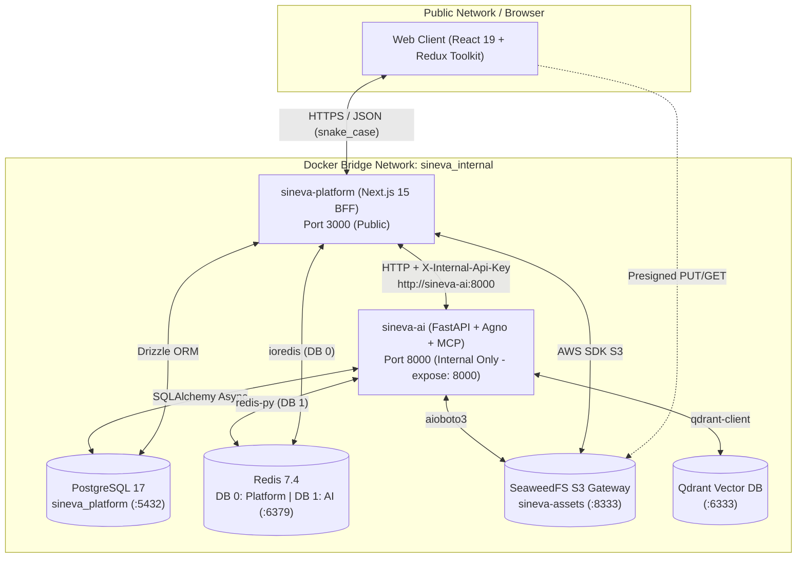

# Architecture & Project Structure Overview

`sineva-platform` is the user-facing web application and Backend-for-Frontend (BFF) API gateway for the Sineva AI ecosystem. Built as a strict TypeScript Turborepo monorepo around Next.js 15+ (App Router), it provides the unified workspace where users collaborate with specialized AI companions (`@SinoPeople`, `@SinoFinance`, `@SinoSales`, `@SinoSocial`, `@SinoHelp`, `@SinoInsights`) while acting as the security and orchestration boundary over the internal Python AI Engine (`sineva-ai`).

---

## 1. High-Level System Topology

All public HTTP traffic enters exclusively through `sineva-platform` on port `3000`. The Python FastAPI AI Engine (`sineva-ai`) never exposes ports to the host machine or public internet; instead, `sineva-platform` communicates with `sineva-ai` over an isolated Docker bridge network (`sineva_internal`) using authenticated service-to-service headers (`X-Internal-Api-Key`).



---

## 2. Monorepo Directory Layout

The repository is organized as a Turborepo monorepo with clear separation between reusable packages (`packages/*`) and deployable applications (`apps/*`):

```text
sineva-platform/
├── .github/
│   └── workflows/
│       └── ci.yml                 # Automated lint, typecheck, test, and build pipeline
├── apps/
│   └── web/                       # Primary Next.js 15+ App Router application & BFF Gateway
│       ├── src/
│       │   ├── domain/            # Enterprise business entities, repository interfaces, domain errors
│       │   ├── application/       # Use cases, DTOs, validation schemas, application services
│       │   ├── infrastructure/    # Drizzle DB, Redis, SeaweedFS S3, Internal AI HTTP Gateway
│       │   ├── presentation/      # Redux store/slices, UI components, hooks, design tokens
│       │   └── app/               # Next.js App Router pages and /api/v1/* Route Handlers
│       ├── next.config.ts
│       ├── tsconfig.json
│       └── vitest.config.ts
├── packages/
│   ├── shared/                    # @sineva/shared: Response envelopes, snake_case utilities, shared types
│   │   └── src/
│   │       ├── index.ts
│   │       ├── response.ts        # createSuccessResponse, createPaginatedResponse, createErrorResponse
│   │       └── snake_case.ts      # Compile-time and runtime snake_case key enforcement
│   └── ui/                        # @sineva/ui: Shared accessible UI primitives (Radix + CVA + Tailwind)
│       └── src/
│           └── index.tsx
├── docs/                          # Comprehensive YAML-frontmatter engineering documentation
├── Dockerfile                     # Multi-stage production container build
├── docker-compose.yml             # Full-stack local & staging orchestration
├── package.json                   # Root workspace scripts and devDependencies
└── turbo.json                     # Turborepo task dependency graph and caching config
```

---

## 3. Core Architectural Pillars

### 3.1 Clean Architecture Inside `apps/web`
Rather than coupling database queries or external API calls directly inside Next.js Route Handlers or Server Components, `apps/web/src` is partitioned into four strict concentric layers:
1. **`domain/`**: Pure TypeScript entities, value objects, and repository/gateway interfaces. Zero framework imports.
2. **`application/`**: Use cases (`ListAgentsUseCase`, `SendAgentChatUseCase`, `CreatePresignedUploadUseCase`) that orchestrate domain interfaces.
3. **`infrastructure/`**: Concrete adapters for PostgreSQL (Drizzle ORM), Redis (`ioredis`), SeaweedFS S3 (`@aws-sdk/client-s3`), and the internal AI Engine HTTP client (`AiEngineHttpGateway`).
4. **`presentation/` & `app/`**: Next.js Route Handlers (`/api/v1/*`), Swagger UI (`/api-docs`), React components, and Redux Toolkit state slices.

### 3.2 End-to-End `snake_case` Contract
Because `sineva-platform` (TypeScript) and `sineva-ai` (Python 3.13 + Pydantic + SQLAlchemy) share PostgreSQL, Redis, and JSON payloads over the wire, **every data property key** across database columns, REST request/response payloads, OpenAPI schemas, and Redux state slices uses strict `snake_case` (e.g., `agent_slug`, `conversation_id`, `total_items`, `request_id`). Zero runtime camelCase-to-snake_case translation overhead is incurred.

### 3.3 Standardized API Envelope
Every endpoint under `/api/v1/*` returns the deterministic `ApiResponse<T>` envelope from `@sineva/shared` (`success`, `status`, `message`, `data`, `meta`, `errors`), matching the exact schema returned by `sineva-ai`.
