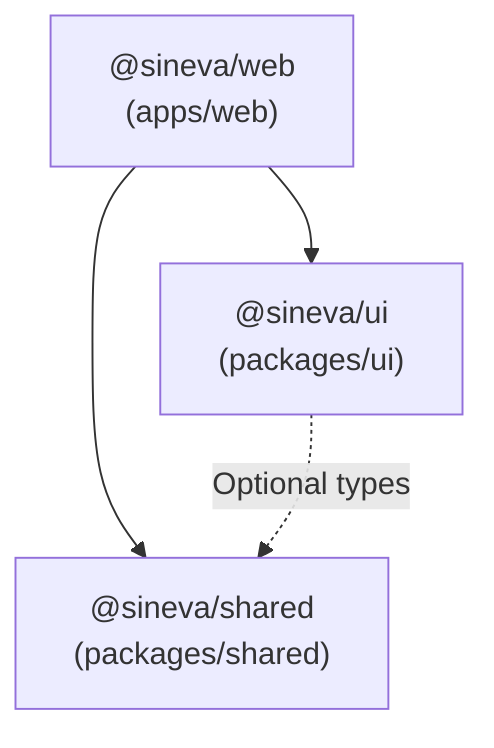

# Turborepo Workspaces & Build Pipeline

`sineva-platform` uses **Turborepo** with npm workspaces (`"workspaces": ["apps/*", "packages/*"]`) to manage shared libraries, enforce strict module boundaries, and parallelize builds, linting, typechecking, and test execution.

---

## 1. Workspace Packages Inventory

| Workspace Package | Directory | Package Name | Purpose & Exports |
| :--- | :--- | :--- | :--- |
| **Web Application & BFF** | `apps/web` | `@sineva/web` | Next.js 15+ App Router application, `/api/v1/*` BFF endpoints, OpenAPI `/api-docs`, Clean Architecture layers, and Redux UI. |
| **Shared Core Utilities** | `packages/shared` | `@sineva/shared` | Standardized API response envelope (`createSuccessResponse`, `createPaginatedResponse`, `createErrorResponse`), `snake_case` validators/converters, and cross-package TypeScript contracts. |
| **Shared UI Primitives** | `packages/ui` | `@sineva/ui` | Design-system primitives (`Button`, `Badge`, `Card`, layout primitives) styled with CVA and Sineva design tokens. |

---

## 2. Package Dependency Graph

Packages follow a strict directed acyclic graph (DAG). Circular dependencies between workspaces are forbidden.



### Dependency Rules
1. **`@sineva/shared`** has **zero** internal workspace dependencies. It may only depend on pure utility types or standard runtime APIs so it can be imported in Node.js, Edge Runtime, or browser bundles.
2. **`@sineva/ui`** contains stateless/reusable React UI primitives and must never import application-specific use cases, Redux stores, or database drivers from `@sineva/web`.
3. **`@sineva/web`** consumes both `@sineva/shared` and `@sineva/ui`, transpiling them seamlessly via `transpilePackages: ['@sineva/shared', '@sineva/ui']` in `apps/web/next.config.ts`.

---

## 3. Turborepo Task Pipeline (`turbo.json`)

The root `turbo.json` defines deterministic task orchestration and caching behavior:

```json
{
  "$schema": "https://turbo.build/schema.json",
  "tasks": {
    "build": {
      "dependsOn": ["^build"],
      "outputs": [".next/**", "!.next/cache/**", "dist/**"]
    },
    "dev": {
      "cache": false,
      "persistent": true
    },
    "lint": {
      "dependsOn": ["^build"]
    },
    "typecheck": {
      "dependsOn": ["^build"]
    },
    "test": {
      "dependsOn": ["^build"],
      "outputs": ["coverage/**"]
    }
  }
}
```

### Key Root Scripts (`package.json`)
- **`npm run dev`**: Launches `turbo run dev` across workspaces in watch mode.
- **`npm run build`**: Builds `@sineva/shared` and `@sineva/ui` (`tsc -b`) first (`"dependsOn": ["^build"]`), then builds `@sineva/web` (`next build`).
- **`npm run typecheck`**: Runs `tsc --noEmit` across every workspace in parallel after upstream declaration files are built.
- **`npm run lint`**: Executes ESLint across all workspaces with zero-warning tolerance.
- **`npm run test`**: Executes Vitest test suites across `@sineva/shared`, `@sineva/ui`, and `@sineva/web`.

---

## 4. Adding a New Shared Utility or UI Component

1. **Shared Utility (`@sineva/shared`)**:
   - Create the module in `packages/shared/src/<module_name>.ts` using `snake_case` filenames.
   - Export all public types and functions from `packages/shared/src/index.ts`.
   - Add a companion unit test in `packages/shared/src/<module_name>.test.ts`.
2. **UI Primitive (`@sineva/ui`)**:
   - Create the component in `packages/ui/src/<component_name>.tsx`.
   - Use semantic CSS variables (`var(--color-surface)`, `var(--color-action-primary)`) rather than hardcoded hex colors.
   - Re-export from `packages/ui/src/index.tsx`.
