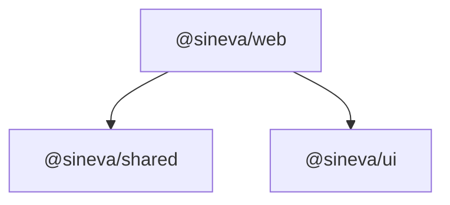

# Turborepo Workspaces and Build Pipeline

The repo is an npm workspaces monorepo (`"workspaces": ["apps/*", "packages/*"]`, `packageManager: npm@11.19.0`, Node `>=24`) with Turborepo running the tasks. Root scripts call `turbo run <task>`. Source of truth: root `package.json`, `turbo.json` and each workspace's `package.json`.

## 1. Workspaces

| Workspace | Directory | Contains |
| :--- | :--- | :--- |
| `@sineva/web` | `apps/web` | The Next.js 16.4 app and BFF: routes, backend layers, client UI, Prisma. See [overview](overview.md). |
| `@sineva/shared` | `packages/shared` | `ApiResponse<T>` and helpers (`createSuccessResponse`, `createPaginatedResponse`, `createErrorResponse`, `generateRequestId`), the `ErrorDetail`, `ResponseMeta` and `PaginationMeta` types, and the `snake_case` helpers (`toSnakeCase`, `isSnakeCaseKey`, `assertSnakeCaseKeys`). One test file: `response.test.ts`. |
| `@sineva/card-schemas` | `packages/card-schemas` | Typed result card registry (ADR-0025): JSON Schema 2020-12 files in `schemas/{card_type}/v{n}.json`, an Ajv validator with the FR-AX-09 rules, pure upcasters, generated TypeScript types (`npm run generate`), and the drift test against the sineva-ai copy. Server only: the browser never imports it. Apps consume it through the `@sineva/card-schemas` path alias, like `@sineva/i18n`. |
| `@sineva/ui` | `packages/ui` | `cn`, `Button`, `Card`, `Badge`, `Container`, `StatusPill`, built with Radix Slot, class-variance-authority and tailwind-merge. No tests of its own. |

Both packages are consumed as TypeScript source: `main`, `types` and `exports` point at `src/index.ts` (`src/index.tsx` for ui). `apps/web/next.config.ts` lists them in `transpilePackages`, so Next compiles them. Their `build` script is `tsc --noEmit`, which only type-checks and produces no `dist`.

## 2. Dependency graph

Current rules, matching the `package.json` files:

1. `@sineva/shared` has no workspace dependencies, only dev dependencies. Keep it free of React and Node-only APIs so any runtime can import it.
2. `@sineva/ui` depends on no workspace package. It must not import `@sineva/web` code (Redux, use cases, the container).
3. `@sineva/web` depends on both, declared as `"*"`.
4. No cycles between workspaces.

`@sineva/shared` is not the same as `apps/web/src/shared`. The package holds the response envelope and helpers used by the backend and by tests. The folder holds the view types the browser reads (`AgentView`, `ChatReplyView`). Do not put one in the other.

## 3. Tasks (`turbo.json`)

| Task | `dependsOn` | Notes |
| :--- | :--- | :--- |
| `build` | `^build` | Outputs `.next/**` (except `.next/cache/**`) and `dist/**`. |
| `dev` | none | `cache: false`, `persistent: true`. |
| `lint` | `^lint` | |
| `typecheck` | `^typecheck` | |
| `test` | `^build` | Outputs `coverage/**`. |
| `test:integration` | none | `cache: false`, env `TEST_DATABASE_URL`. Only `@sineva/web` defines it. |

What each workspace runs for those tasks:

| Task | `@sineva/shared` | `@sineva/ui` | `@sineva/web` |
| :--- | :--- | :--- | :--- |
| `build` | `tsc --noEmit` | `tsc --noEmit` | `npm run db:generate && next build` |
| `lint` | `tsc --noEmit` | `tsc --noEmit` | `eslint . --max-warnings 0` |
| `typecheck` | `tsc --noEmit` | `tsc --noEmit` | `npm run db:generate && next typegen && tsc --noEmit` |
| `test` | `vitest run` | `tsc --noEmit` | `vitest run` |
| `test:integration` | none | none | `npm run db:generate && vitest run -c vitest.integration.config.ts` |

Root scripts: `dev`, `build`, `lint`, `typecheck`, `test`, `test:integration` (all through turbo), `format` and `format:check` (prettier), `docker:up`, `docker:down` and `docker:reset`.

Gotchas:

- `@sineva/shared` and `@sineva/ui` have no real lint step: their `lint` is a type check. ESLint runs only in `@sineva/web`.
- `npm run docker:down` keeps volumes. `npm run docker:reset` runs `docker compose down -v`, deletes volumes including the shared Postgres data, and refuses to run without `CONFIRM_RESET=yes`.
- Prisma commands (`db:generate`, `db:migrate:dev`, `db:migrate:deploy`, `db:seed`) are scripts of `@sineva/web`. From the root, run them as `npm --workspace=@sineva/web run <script>`.
- `build`, `typecheck` and `test:integration` run `prisma generate` first, and `dev` does too. The generated client is gitignored build output.
- `format:check` is not part of CI, and the code does not pass it today. See [coding standards](../engineering/coding_standards.md).

## 4. Adding code to a package

`@sineva/shared`:

1. Create `packages/shared/src/<name>.ts` in `snake_case`.
2. Export it from `packages/shared/src/index.ts`.
3. Write the failing test first in `packages/shared/src/<name>.test.ts` (R-01).

`@sineva/ui`:

1. Create `packages/ui/src/<name>.tsx`, or add to `index.tsx` (the current components all live there).
2. Style with semantic tokens (`var(--color-surface)`), not hex (R-30).
3. Export it from `packages/ui/src/index.tsx`.
4. The package has no test runner. Run `npm run typecheck`, and exercise the component through the web app.

A new workspace needs `build`, `lint`, `typecheck` and `test` scripts so turbo can run them, and an entry in the table above.
