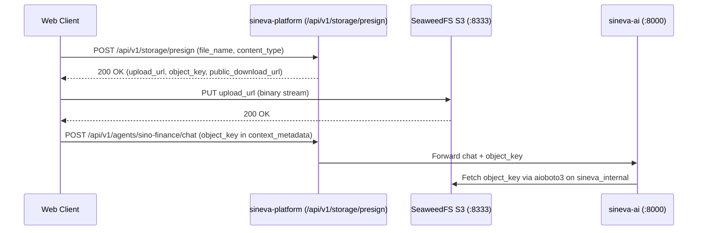

# ADR-002: SeaweedFS S3 Architecture for Multi-Agent Artifacts

## Status
**Accepted** (2026-10-21)

---

## 1. Context

Sineva AI companions (`@SinoFinance`, `@SinoPeople`, `@SinoSocial`, `@SinoInsights`) frequently ingest and produce thousands of small-to-medium files: PDF financial statements, CSV exports, generated charts, and audio/video snippets. Traditional object stores often suffer from metadata amplification on millions of small files, while routing binary uploads through the Next.js Node.js process creates memory pressure.

---

## 2. Decision: SeaweedFS with S3 Gateway + Direct Presigned Uploads

We deploy a 4-component **SeaweedFS** topology on `sineva_internal`:
1. **`seaweedfs-master` (`:9333`)**: Manages volume-to-machine mapping with O(1) disk seek overhead per file.
2. **`seaweedfs-volume` (`:8080`)**: Stores packed needle blobs efficiently on disk.
3. **`seaweedfs-filer` (`:8888`)**: Provides hierarchical directory paths and metadata.
4. **`seaweedfs-s3` (`:8333`)**: Exposes a full AWS S3-compatible API (`S3_FORCE_PATH_STYLE=true`) consumed by `@aws-sdk/client-s3` in `sineva-platform` and `aioboto3` in `sineva-ai`.

### Direct Presigned Upload Flow

